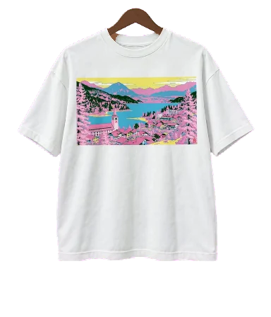
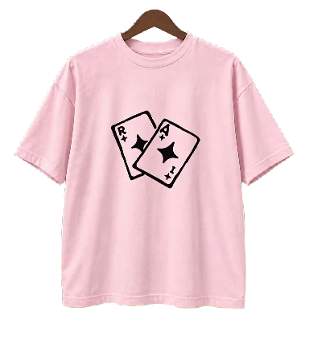

# Interactive Garment Starter

Turn product photos into an interactive clothing website with your AI agent. Hover a garment to turn it, move away to reverse, and click to inspect. On a phone, swipe to browse and tap to open.

By **Amir Mušić**. Interaction concept: [@cambreedesigns](https://x.com/cambreedesigns/status/2104999693113766152). This is an independent implementation.

## Start in Codex or Claude Code

Give [this repository](https://github.com/amirmushichge/interactive-garment-starter) to your coding agent and paste this message:

```text
Use this repository to build my interactive clothing website.
Read AGENTS.md and START-HERE.md, then follow docs/agent-workflow.md.
Set up the project and open the included example for me first.
Then help me replace one garment with my own photos or artwork.
Handle the technical work. Ask me for missing files, account access,
visual decisions and a spending limit before any paid generation.
Keep the result local until I approve publication.
```

Your agent checks your computer, prepares the tools and opens a working example. You choose your product, review the visuals and approve any generation costs. The two included shirts are already animated, so trying them requires no API account or generation payment.

**Using a downloaded ZIP?** Give its local folder to the agent with the same message. A coding agent with local file and terminal access can carry out setup. If a connection or permission is missing, it should explain the exact next step.

## The included example

| Alpine lake · LTX-2.5 Pro | Wild cards · Kling 3.0 through Pika |
| --- | --- |
|  |  |

Both original prints were supplied by Amir. The cotton bases and matched views were generated with an image tool; the exact graphics were placed on the fronts. The white shirt’s turn uses LTX-2.5 Pro; the pink shirt’s turn uses Kling 3.0 through Pika. These garment concepts are bundled with the motion files, interface and prompts. Clothing-brand catalog media is excluded.

The example includes reversible rail turns, moving neighbors, touch browsing, keyboard controls and static front/back detail views. The [example build](docs/example-build.md) records the production decisions and costs.

## From the example to your own website

1. **See it working.** Your agent runs the supplied example and opens a local preview
2. **Choose a product.** Give it front/back photos or your original print, plus any visual references
3. **Review the image anchors.** Your agent prepares the front and strict side profile for you to approve
4. **Approve a generation budget.** The agent checks your available image/video tools, helps connect an account and quotes settings, attempts and a spending cap
5. **Review your website.** The agent generates or imports the turn, removes the background, adds the garment and tests the actual interaction

Ask for changes in the same chat. Once you approve the local result, ask the agent to publish it to your chosen host. If its environment lacks an image or video tool, it helps you connect one or import prepared media. Your original photos stay available for comparison throughout.

## Included for your agent

- [AGENTS.md](AGENTS.md): automatic entry rules for coding agents
- [START-HERE.md](START-HERE.md): the first-run path
- [Agent workflow](docs/agent-workflow.md): environment setup, generation, processing, review and handoff
- [Image and video prompts](prompts/agent-bootstrap.md): orchestration brief with links to the individual prompts
- [Technical workflow](docs/workflow.md): exact requests, file contract and processing options
- [Troubleshooting](docs/troubleshooting.md) and [performance](docs/performance.md)
- A local LTX connector, background-removal tools, tests and a static build

Prepared footage plays locally in the browser. Generating your own footage is a separate, potentially paid step, approved before it runs.

<details>
<summary>Manual commands for developers</summary>

The example needs Node.js 20.6+ and has no npm packages. From the repository root:

```sh
node scripts/serve.mjs
# Open the URL printed by the server (default: http://127.0.0.1:5264)
```

Checks and static build:

```sh
node --test tests/runtime.test.mjs tests/server.test.mjs tests/ltx.test.mjs
node scripts/audit.mjs
node scripts/build.mjs
```

For optional footage processing, use Python 3.10+, Pillow, NumPy and FFmpeg/ffprobe. The agent setup instructions cover a project-local environment and tool discovery. Deploy only `dist/`; keep source photos, keys and intermediate generations private.

</details>

The [first-run verification](docs/first-run-verification.md) records what was tested and what remains environment-dependent.

## Scope and permissions

This method plays a prepared turn between two orientations. Detail views show static front/back images. A shopping cart, payments and inventory would be additional work. AI can change print, fabric or silhouette: review generated media against your source photos, at actual UI speed and on the devices you intend to support.

Code and procedural fixtures: MIT. The bundled original-art garment media is also released under MIT, within the scope described in LICENSE-ASSETS.md. See [LICENSE-ASSETS.md](LICENSE-ASSETS.md), [rights and attribution](docs/rights.md), and [third-party notices](THIRD_PARTY_NOTICES.md). Manrope uses SIL Open Font License 1.1.
